# Actuality — Architecture

This document summarizes the app-spec as a set of architecture diagrams. It adds no new requirements. Where it summarizes, the spec chapters (cited as `02` §1 and so on) are normative.

**Summary:** Actuality is an Electron + Vue 3 + TypeScript desktop client for an **Actual Budget sync server**. Its layout, behavior and wording are inspired by YNAB 4. It has three processes:

- a **sandboxed renderer** for all UI,
- a **main process** for OS integration, settings and secrets,
- an **API host** utility process. This is the *only* place that loads `@actual-app/api`.

The app has no database of its own. Budget data lives in Actual's own cache. App-only metadata is stored inside Actual as tags, note tokens and reserved notes. A **write gate** blocks every change while the server can't be reached.

---

## 1. System context

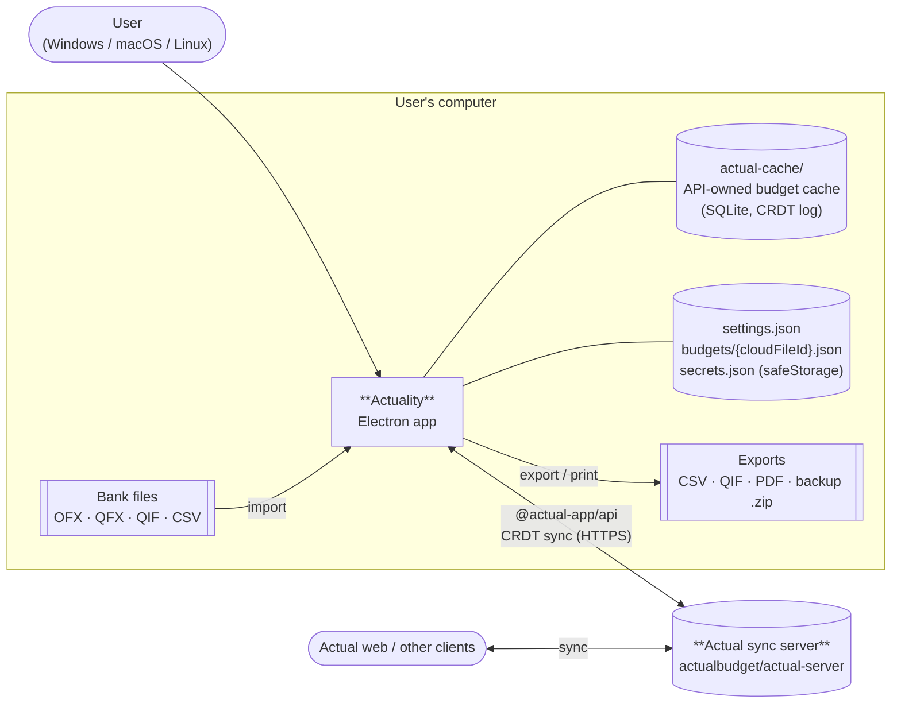

- The server only stores and relays CRDT changes. All queries and budget maths run on the client inside `@actual-app/api` (`03` §1).
- The metadata the app writes is visible in Actual web: transaction tags in notes, check numbers as `⟦chk n⟧` tokens, and the approval marker as `#needs-review`. The app must preserve anything it doesn't understand (`04` §5).

---

## 2. Process model

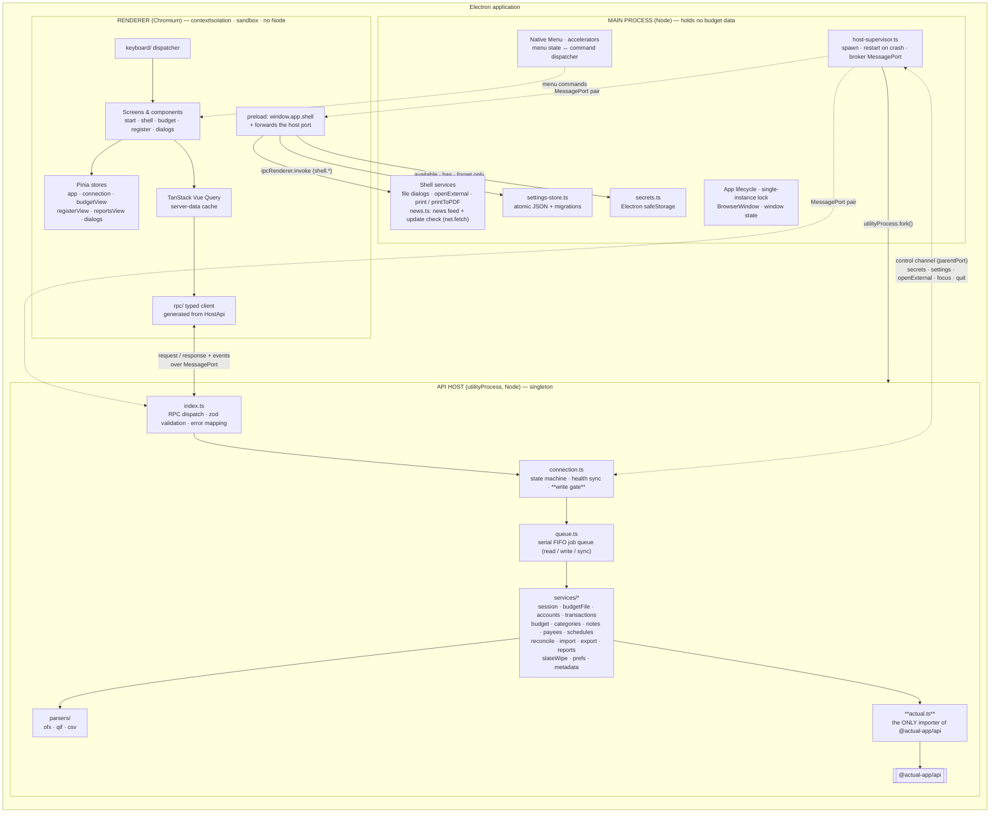

**Process rules** (`02` §1, §6):

| # | Rule |
| --- | --- |
| P1 | The renderer has `contextIsolation`, `sandbox` and no `nodeIntegration`. Its only bridges are `window.app.shell.*` (to main) and the host `MessagePort` that preload forwards with `window.postMessage` (to the host, `02` §4). It never imports `@actual-app/api`. |
| P2 | `src/host/actual.ts` is the only module that imports `@actual-app/api`. The API keeps global state (one open budget), so the host is a singleton and every API call runs inside a **serial queue job**. |
| P3 | Bulk business rules (commit pipeline, import, schedule entry, slate wipe) live in the host's `services/`. Pure rules live in `src/shared/` and are used by both host and renderer. |
| P4 | Main holds no budget data. Passwords reach the host once, on connect. No secret value ever travels to the renderer: it can only ask whether a secret exists, or forget it. |
| P5 | If the host crashes (or is stuck on an API call that never settles), main restarts it. The renderer keeps its UI state and shows "Reconnecting…". The new host reopens the session automatically from main's record and the stored secrets, and asks only for what wasn't stored (`03` §6.5). After 3 crashes in 5 min, main gives up and asks the user to restart. |
| P6 | CSP is `script-src 'self'`. Window-open and external navigation are denied. External links go through `shell.openExternal` (http/https only). The renderer makes no network request: main fetches the news feed and the latest version, each only while its preference is on, and validates the feed (`24` §4.2). |
| P7 | Main owns settings and secrets. The host reaches them, plus `openExternal`, window focus and the quit handshake, only through the typed **control channel** over `parentPort` (`02` §4.1). |

---

## 3. Source modules and dependency direction

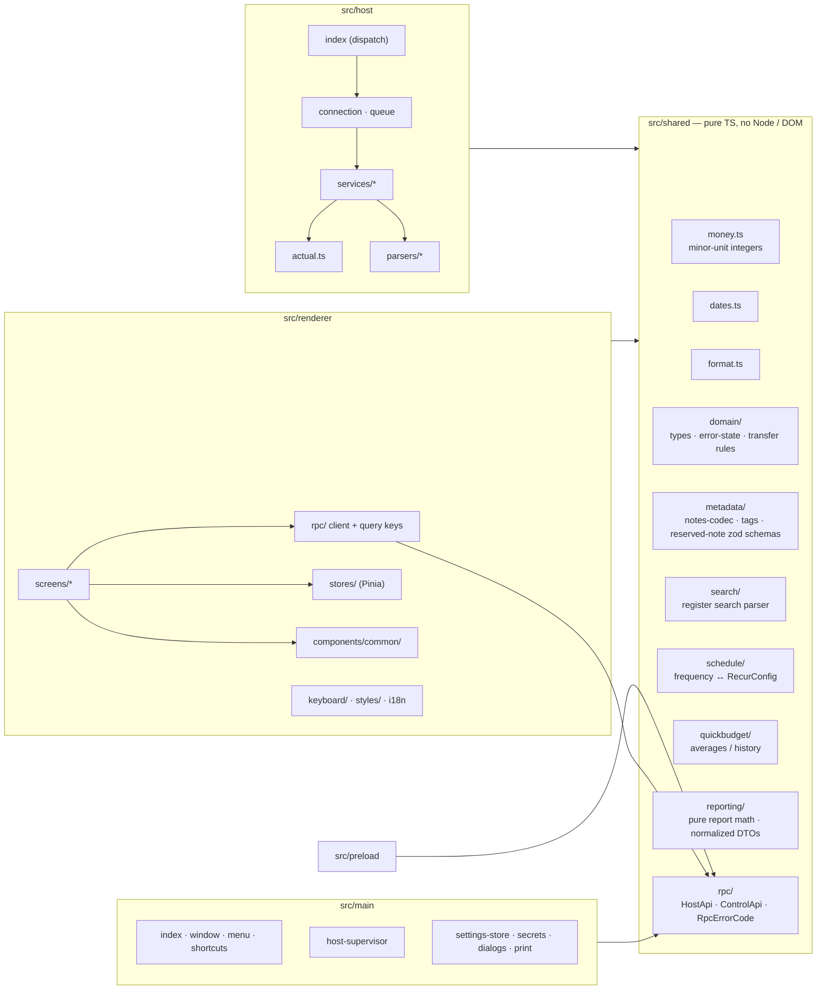

Allowed dependencies point **toward `shared`** only. `host`, `main` and `renderer` never import each other. They meet only through `shared/`: the RPC contracts in `shared/rpc/` (`host-api.ts` between renderer and host, `control-api.ts` between main and host) and the pure rules and types. ESLint import boundaries enforce this, along with the rule that only `actual.ts` may import `@actual-app/api`.

---

## 4. RPC contract

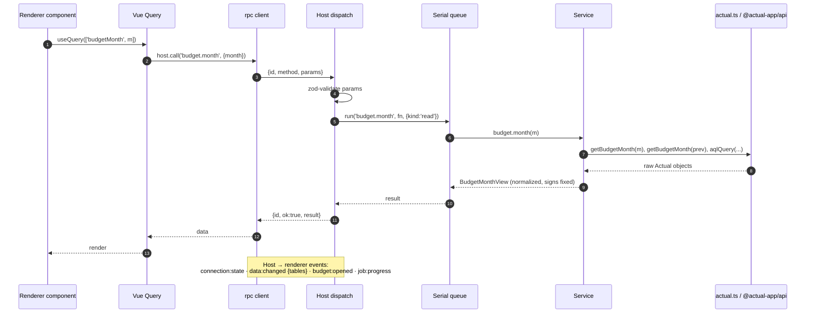

- **Request:** `{ id, method, params }`. **Response:** `{ id, ok: true, result }` or `{ id, ok: false, error: { code, message, details? } }`.
- **Error codes:** `offline`, `auth`, `not-found`, `validation`, `conflict`, `timeout`, `actual`, `internal`. A `timeout` fails only its own call, except for the jobs that run `init`/`downloadBudget` (`session.connect`, `session.openBudget` and the re-init retry), which put the connection into `Error` (`03` §3). Reads like the one above skip the write gate.
- **Method groups** (`03` §8): `session`, `budgetFile`, `accounts`, `transactions`, `budget`, `categories`, `notes`, `payees`, `schedules`, `reconcile`, `import`, `export`, `reports`, `slateWipe`, `prefs`.
- **Reports:** `reports.get` is a strict, read-only host RPC. It runs one report calculation in one serial queue job, returns aggregate DTOs rather than the ledger, and may read cached Actual data offline. Pure calculations live in `shared/reporting/`. Vue Query requests only the active report; its key includes the report kind, effective filters, and options.
- **Cache invalidation:** after a write or a successful sync the host emits `data:changed`. The renderer invalidates its Vue Query cache, and only active queries refetch. Reports depend on transactions, accounts, categories/category groups and mappings, payees and mappings, and currency/format preferences (`03` §4.1).

---

## 5. Write path: the gate and commit pipeline

The diagram shows a register edit going through `transactions.commit` (`11` §6, `03` §5).

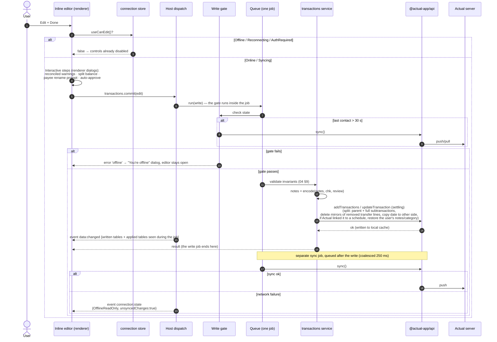

---

## 6. Connection state machine

This lives in `host/connection.ts` (`03` §4). The renderer mirrors it in the Pinia `connection` store. `useCanEdit()` is true only in **Online** and **Syncing**.

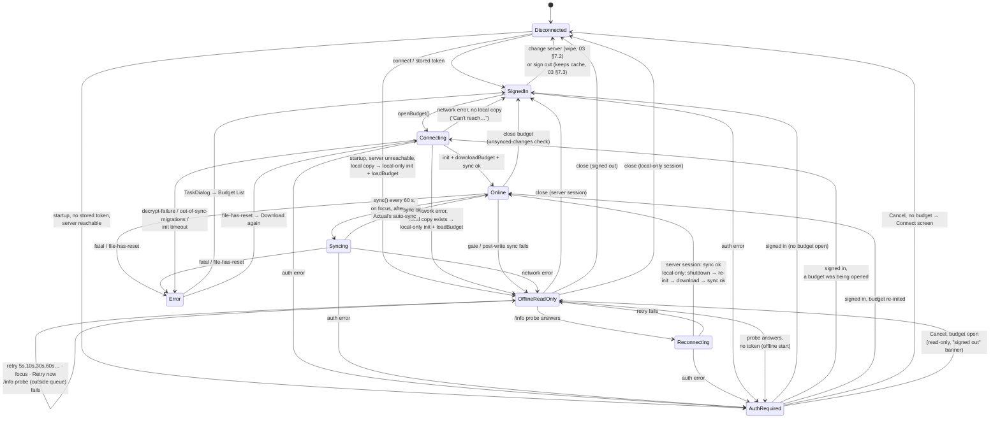

`03` §4 has the full transition table, including the "any state → Error" cases this diagram leaves out. A startup with the server unreachable and nothing to open offline stays `Disconnected`, showing the Budget List in its "Can't reach…" state. A host crash isn't a state: the restarted host replays the session (connect → open, or the offline fallback) and lands back in the matching state (`03` §6.5). At the session's first `Online`, the session start tasks run: ensure the `needs-review` tag entity, then the carryover extension (`03` §6.4).

| State | Writes | UI |
| --- | --- | --- |
| SignedIn | n/a (no budget) | Budget List; Create / Import a budget allowed |
| Online / Syncing | allowed | sidebar indicator "Connected" / spinning |
| OfflineReadOnly / Reconnecting | **blocked** | yellow ConnectionBanner + **Retry now**. Navigation, search, export and print still work. |
| AuthRequired | blocked | modal "Sign in to your Actual server", over the budget or the Budget List |
| Error | blocked | TaskDialog, then Budget List (`file-has-reset`: **Download again** / **Close budget**) |

---

## 7. Data and persistence

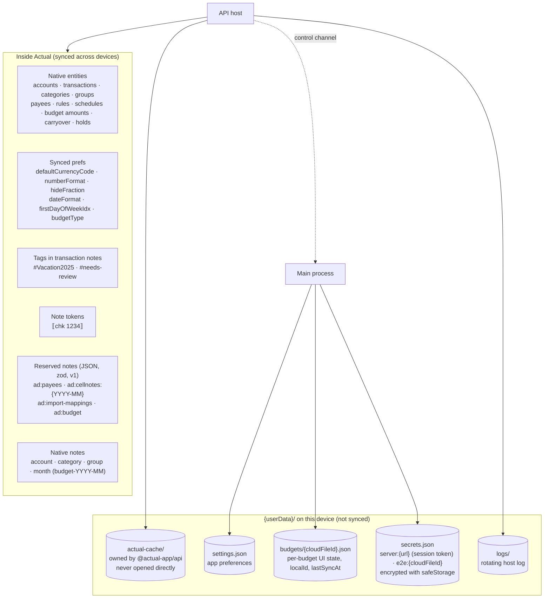

Main writes every `{userData}` JSON file. The host reaches the keys it needs (`serverUsers`, `localId`, `lastSyncAt`, secrets) through the control channel. **Change server** wipes `actual-cache/`, every `budgets/*.json` file, all secrets and the recent-budget list (`03` §7.2), so the cache only ever holds the current server's budgets.

**Domain mapping.** The host converts Actual objects to the domain types in `shared/domain/`. The renderer only ever sees domain types.

| Concept | Representation |
| --- | --- |
| Money | integer minor units everywhere, **always ×100** whatever the currency; display decimals follow the currency (0 for JPY). All formatting goes through `money.ts`. No floats (enforced by ESLint). |
| Dates / months | `'YYYY-MM-DD'` / `'YYYY-MM'` strings, handled with date-fns, no time zones |
| Cleared state `U/C/R` | Actual `cleared` + `reconciled` booleans |
| Review state, check number and note tags | decoded from `notes` by `notes-codec`. `notes` retains user tags and excludes app metadata. `rawNotes` is kept for round-trip. |
| Last reconciled date | Actual's `accounts.last_reconciled` (read with AQL, written at Finish) |
| Payee disabled | `ad:payees` |
| Payee rename rules / auto-category | Actual rules (`pre` stage on `imported_payee` / `default` stage on `payee`) |
| Error levels | derived client-side (`shared/domain/error-state.ts`): error > forReview > needsCategory > none |
| Budget numbers | Actual's engine (`getBudgetMonth`), normalized to `BudgetMonthView` and identity-checked |

Writes to reserved notes are read-modify-write inside **one queue job**. They are last-writer-wins on the whole note. If a note holds invalid JSON, an `ad-bak:{id}` copy is made before the first overwrite. That prefix sorts outside the `ad:` range query, so a backup is never loaded as metadata.

---

## 8. Renderer composition

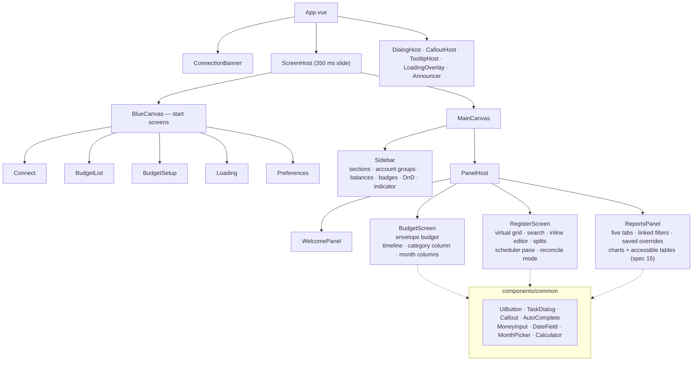

**State ownership:**

| Kind of state | Owner |
| --- | --- |
| Server data (accounts, transactions, budget months, payees, active report DTO) | **Vue Query**. Keys such as `['budgetMonth', m]` and `['reports', kind, filters, options]`, invalidated on `data:changed`. |
| UI and view state (screen, selection, editor, Reports tab and filter state) | **Pinia** stores |
| Persisted per-device preferences and saved report filters | `useSettings()` → `shell.settings.*` → main |
| Theme (palette) | `appearance` + `colorVision` settings → `data-theme` / `data-cvd` on `<html>`; main mirrors `appearance` to `nativeTheme` |
| Connection and `canEdit` | Pinia `connection` store, fed by `connection:state` events |

**Theming.** Every color is a CSS token in `styles/tokens.css` with four values: Light (inspired by YNAB 4, with contrast fixes such as a deeper sidebar blue), Dark, Light CVD and Dark CVD (color-blind safe). Every text pair meets WCAG AA (`05` §1.10). The palette switches live, and prints always use a light palette (`05` §1.9).

Shortcuts come from native menu accelerators plus a single capture-phase `keydown` dispatcher. Modals suppress screen handlers, and Esc closes a callout first (`06` §6).

---

## 9. Key flows

### 9.1 Startup and budget open (`07` §1, `03` §6)

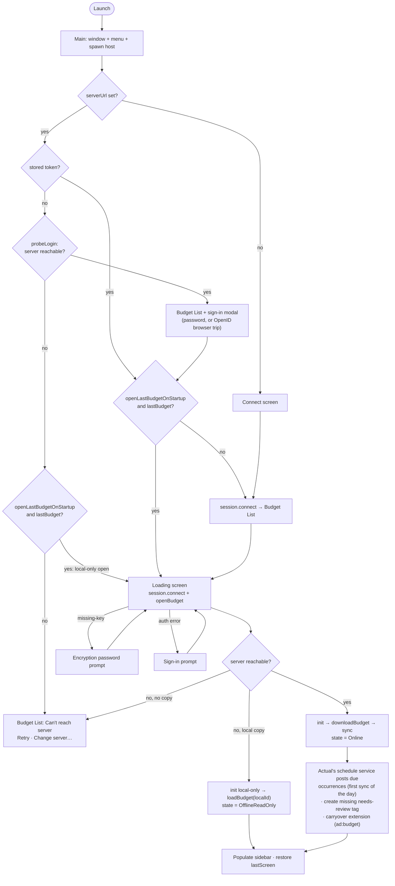

### 9.2 Bank import (`16` §1)

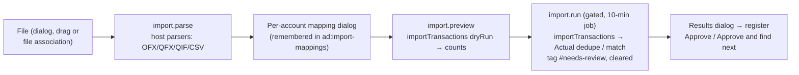

---

## 10. Build, packaging and CI

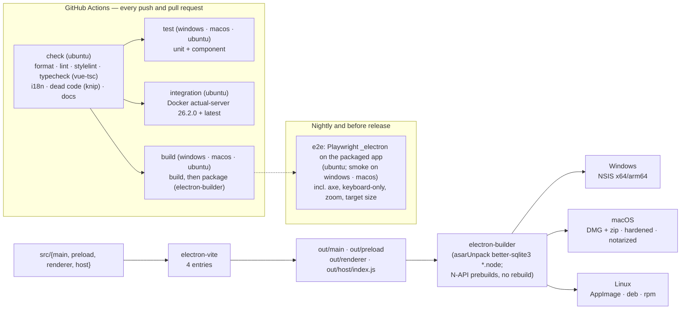

**Tech stack:** Electron (bundling Node ≥ 22.14) · electron-vite · Vue 3 `<script setup>` · Vue Router (hash) · Pinia · @tanstack/vue-query · @tanstack/vue-virtual · @floating-ui/dom · date-fns · vue-i18n · zod · Source Sans 3 · Lucide · Vitest (+ @vue/test-utils, happy-dom, fast-check) · Playwright · ESLint + Prettier + stylelint · electron-builder. Versions are pinned exactly.

---

## 11. Test architecture

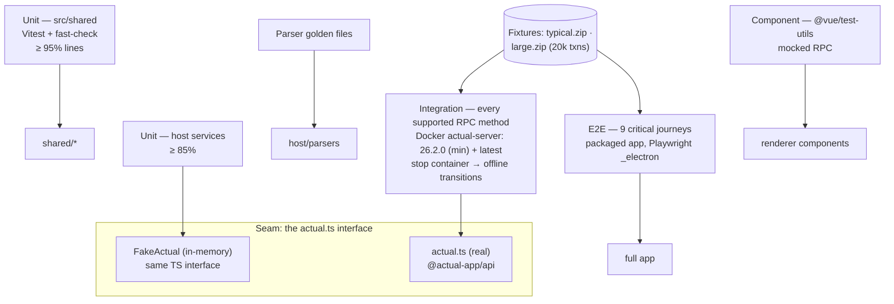

**Performance targets** (`21` §5):

- cold start under 3 s
- register with 20k transactions opens in under 1.5 s and scrolls at 60 fps
- search under 200 ms per keystroke
- budget cell commit under 100 ms
- under 400 MB of memory in total

---

## 12. Design choices (index)

| ID | Choice | Rationale |
| --- | --- | --- |
| D1 | App-only metadata stored in Actual (tags, note tokens, `ad:` reserved notes) | No local DB; syncs across devices |
| D2 | Budget maths from Actual's engine | Numbers always match Actual web |
| D3 | Envelope budgets only | Actuality is inspired by envelope budgeting; Tracking mode is out of scope |
| D4 | Spec chapters are self-contained, with acceptance criteria | Each feature can be understood from its chapters alone |
| D5 | Money as integer minor units | No floating-point error |
| D6 | `@actual-app/api` only in a utility-process API host | Keeps the UI responsive, isolates crashes, keeps the renderer sandboxed |
| D7 | No third-party names, logos, images or fonts | Legal / branding |
| D8 | Out of scope: Features not in the Actual API scope. | Not available through the API, or not wanted |
| — | Main ↔ host **control channel** over `parentPort` for secrets, settings, `openExternal`, focus and quit; the renderer can't read secrets | Main owns the files, and secrets must never reach the renderer. |
| — | Connection state `SignedIn` (server session, no budget open) | The Budget List and budget creation need a server session without an open budget |
| — | **Change server wipes** the cache, device settings, secrets and recent budgets | A cached budget doesn't record its server. |
| — | No stored token at startup → sign-in modal over the Budget List (OpenID: a browser trip each launch) | Without "Stay signed in" nothing that signs in is stored |
| — | A job timeout fails only that call; only timeouts of the jobs that run `init`/`downloadBudget` (`session.connect`, `session.openBudget`, the re-init retry) mean `Error` | One slow report shouldn't close the budget. |
| — | The host deletes the mirrors Actual only unlinks when a split (or a split transfer line) is deleted | Matches the reference design; avoids orphaned transfer rows. |
| — | A transfer row a split in another account created can't be deleted, moved to another account, or change its amount, payee or account: it's changed from its split | Actual would rewrite the split's line to match (a move retargets it), changing the split from another register. |
| — | Typed payee names are normalized to the stored payee's capitalization; renaming is explicit | Typing a name never renames a payee by accident |
| — | Slate wipe is one long job that keeps carryover flags | `setBudgetCarryover` propagates to later months. A slow run on large budgets is accepted. |
| — | `carryoverSeenEnd` lives in the synced `ad:budget` note | Every device continues the carryover extension where the last one stopped |
| — | Host crash → automatic reopen of the session; stuck API calls end in a host restart | Users keep their place; a hang can't freeze the queue for ever. |
| — | The host keeps the open budget's encryption password in memory for the session | Re-auth and reconnects don't ask again. |
| — | **Sign out** deletes the token, every remembered encryption password and `lastBudget`, but keeps the cache; the user-switch rule cleans up for another user | Lets several users share one computer and server, without the next user seeing an offline budget or reusing a saved password. |
| — | Cancelling the sign-in modal with a budget open keeps it open read-only | Users can keep reading a budget they can't sign in to. |
| — | After Actual links an Actuality-entered transaction to a schedule, the host restores the user's notes and tags, check number, category and approved state | Narrows deviation X23; nothing the user typed is lost. Actual doesn't re-run rules on updates, so the restore holds (`12` §2). |
| — | When the server can't be reached, the Budget List shows no budgets; only the startup fallback opens the last budget offline | One offline path (`03` §6.2) |
| — | Bulk jobs get +100 ms per touched transaction on their timeout | Integration tests show each settled update/delete takes about 60 ms |
| — | Session start tasks (the `needs-review` tag entity, carryover extension) run at the first `Online`, including after an offline start | They are writes, so they wait for the connection |
| — | Serial FIFO queue for all API calls | The API has global state, so calls must not interleave |
| — | A short list of internal handlers via `init().send` (`03` §3), such as `category-move`, `schedule/get-upcoming-dates`, `save-prefs { budgetName }` (rename) and `transactions-batch-update`. Each is wrapped in `actual.ts`, integration-tested, and has a fallback. | The public API does not expose these operations. |
| — | Due scheduled transactions are posted by **Actual's schedule service** (which runs in the API host), not by app code | This uses Actual's existing mechanism and avoids duplicate posting logic. |
| — | Store a server **session token**, never the password, obtained with one REST call `POST /account/login` | The API accepts `sessionToken` but never returns one. A leaked secrets file then can't reveal a reused password. |
| — | Bank text matching a **disabled** payee is imported as `imported_payee` only (no `payee_name`); imports always use `payeeNameNormalization: 'original'` | Actual runs every rule on every import and has no disabled-payee concept. Omitting `payee_name` leaves the payee empty unless a rename rule matches. |
| — | A **fetch timeout wrapper** (15 s; 120 s for download/upload) installed before the API is imported. Reconnect = re-init in the same process. | The API has no request timeouts, so a half-open server hangs `init`, `sync` and `shutdown`. The API reads `globalThis.fetch` once, at load. Re-init works, so no host restart. |
| — | Offline retries probe `GET /info` **outside the queue** first, and queue a `sync()` (server session) or a re-init (local-only session) only if it answers | A queued retry against a dead server would block reads for 10–15 s each time. |
| — | Sign-in follows the server's **active** method: password → token login; **OpenID → browser flow** (loopback `http://localhost:{port}` listener in the host, `shell.openExternal`) → token; others unsupported. No password fallback on OpenID servers. | OpenID is supported. The server does the OAuth exchange and only accepts `localhost` return addresses. The token then works exactly like a password token. |
| — | Multi-user servers: client only. Shared tag on others' budgets; no user or access management. A changed server `userId` **clears the other user's cached budgets**. | One computer may be used by several server users, and their cached budgets must not be visible to each other. |
| — | Settling wrappers for `updateTransaction` / `deleteTransaction` | They resolve before the write lands. A job may only finish once its writes are visible. |
| — | Write gate in the host plus `useCanEdit()` in the UI | The requirement "no changes while offline", with a backstop |
| — | Vue Query for server data, Pinia for view state | Clear cache-invalidation story (`data:changed`) |
| — | `actual.ts` as the test seam | Host services are unit-testable against a fake; integration tests prove the API assumptions |
| D9 | Manual Match = `mergeTransactions`, no Unmatch | Actual stores no matched pairs |
| D10 | Four palettes (Light, Dark, Light CVD, Dark CVD) from CSS tokens; default follows the OS; prints use a light palette | Accessibility; the CVD palettes keep meaning without red vs green. |
| D11 | WCAG 2.2 AA: keyboard, screen-reader and zoom support (`22`); every text color pair passes contrast, so Light deepens the sidebar blue | Usable by everyone; checked by unit, axe and keyboard-only tests. |
| — | Minimum supported Actual server: **26.2.0** | The minimum-version integration suite runs against this release. |
